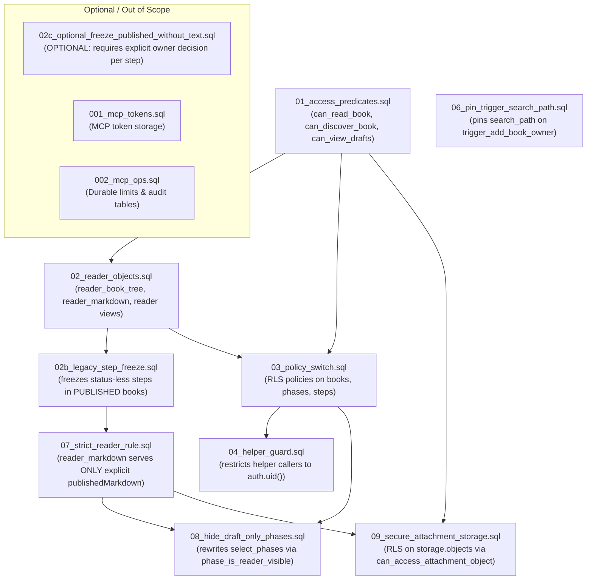

# DevBook — Migration Dependency and Rollback Matrix

**Target Environment:** InsForge Database Migrations (`public` and `storage` schemas)  
**Evaluated Migrations:** `01`, `02`, `02b`, `02c`, `06`, `07`, `03`, `04`, `08`, `09`, `001`, `002`  
**Auditor Role:** PostgreSQL DBA & Release Security Reviewer  
**Evaluation Date:** 2026-10-20  

---

## 1. Migration Dependency Graph



---

## 2. Complete Migration Matrix

| Migration Filename | Migration Purpose | Prerequisites & Dependencies | TEST Status | Type | Rollback Script & Behavior | Destructive / Data Loss Limitations | Required Preflight Checks |
|---|---|---|---|---|---|---|---|
| **01_access_predicates.sql** | Defines core book authorization predicates: `can_read_book`, `can_discover_book`, `can_view_drafts`, `can_manage_members`. | Baseline schema (`books`, `book_members`, `user_followers`, `book_access`). | **APPLIED** | Additive / Helper modification | `01_rollback.sql`: Restores original `can_read_book` and `can_manage_members`, drops new helpers. | Safe. Does not alter table data. Fails if dependent policies exist. | Confirm existing table columns `access_level`, `publication_status`. |
| **02_reader_objects.sql** | Creates reader RPCs (`reader_book_tree`, `reader_step_json`, `reader_markdown`) and reader-safe views. | `01_access_predicates.sql`. | **APPLIED** | Additive | `02_rollback.sql`: Drops reader views and RPC functions. | Safe. Leaves underlying data intact. | Verify `step_type` enum and JSON content structure. |
| **02b_legacy_step_freeze.sql** | Freezes legacy status-less steps in PUBLISHED books by setting `publishedMarkdown := markdown` and `status := 'Published'`. | `01`, `02`. | **APPLIED** (`20261020110927`) | Data Migration | `02b_rollback.sql`: Restores original keys from `_rls02b_step_freeze_backup` where unchanged. Drops backup table. | Semi-destructive if rolled back: restored rows lose draft status. Any step edited since freeze is deliberately preserved. | Query Q11: Verify count of legacy status-less steps before running. |
| **07_strict_reader_rule.sql** | Replaces `reader_markdown()` to return ONLY explicit `publishedMarkdown` string (no fallbacks). Enforces strict reader boundary. | `02b_legacy_step_freeze.sql` (hard assertion: aborts if unfrozen legacy steps exist). | **APPLIED** (`20261020111334`) | Policy-Changing / Tightening | `07_rollback.sql`: Restores `reader_markdown()` with legacy fallbacks. | Safe. Reverts reader filter to allow legacy fallbacks. | Precondition assertion verifies 0 legacy status-less steps remain unfrozen. |
| **06_pin_trigger_search_path.sql** | Pins `search_path = public, pg_temp` on `public.trigger_add_book_owner()`. | Baseline trigger function exists. | **APPLIED** (`20261020111217`) | Configuration Hardening | `06_rollback.sql`: Clears search_path config. | Non-destructive. Restores caller-dependent search_path. | None. |
| **03_policy_switch.sql** | Rewrites RLS policies on `books`, `phases`, `steps` to use access predicates instead of raw queries. | `01_access_predicates.sql`, `02_reader_objects.sql`. | **APPLIED** | Policy-Changing | `03_rollback.sql`: Drops new policies and recreates legacy baseline RLS policies. | High impact: Rolling back re-exposes soft-deleted books and draft steps to direct table queries. | Verify all helper functions have `GRANT EXECUTE TO anon, authenticated`. |
| **04_helper_guard.sql** | Protects SECURITY DEFINER helpers from being probed with arbitrary user IDs by forcing `req_user_id = auth.uid()`. | `01_access_predicates.sql`, `03_policy_switch.sql`. | **APPLIED** | Security Guard | `04_rollback.sql`: Removes the guard condition from helper functions. | Safe. Leaves core permission logic intact. | Verify API role GUC (`current_setting('role', true)`). |
| **08_hide_draft_only_phases.sql** | Rewrites `select_phases` policy using `phase_is_reader_visible()`; hides draft-only phase titles from unauthorized readers. | `01`, `02`, `07`, `03`. | **APPLIED** (`20261020130408`) | Policy-Changing | `08_rollback.sql`: Restores `select_phases` to `can_discover_book(book_id)` and drops helper. | Non-destructive. Draft phase titles become visible again if rolled back. | Verify reader tree and direct table access match. |
| **09_secure_attachment_storage.sql** | Enables RLS on `storage.objects`; grants granular permissions via `can_access_attachment_object()`. | `01`, `07`, `storage.objects` table. | **APPLIED** (`20261020133321`) | Policy-Changing / Storage RLS | `09_rollback.sql`: Drops storage policies, disables RLS on `storage.objects`, revokes storage grants. | **DANGEROUS ROLLBACK:** Disabling RLS on `storage.objects` re-opens F7/F27 (strangers downloading known keys). | Verify bucket `book-assets` exists and `storage` schema is accessible. |
| **02c_optional_freeze_published_without_text.sql** | Freezes steps marked `'Published'` that lack `publishedMarkdown`. | `02b`. | **UNAPPLIED (By Policy)** | Data Migration | `02c_rollback.sql`: Restores keys from `_rls02c_step_freeze_backup`. | **HIGH RISK OF PUBLISHING UNAPPROVED DRAFT TEXT.** Must NOT be applied without manual owner review per step. | Query Q12: List all step IDs, titles, and timestamps matching rule 2. |
| **001_mcp_tokens.sql** | Creates table `public.mcp_tokens` for MCP authentication. | Baseline schema. | **APPLIED** | Additive (MCP) | `001_rollback.sql`: Drops `public.mcp_tokens`. | Destructive: Revokes and drops all MCP tokens. | Verify MCP schema. |
| **002_mcp_ops.sql** | Creates `mcp_rate_limits`, `mcp_audit_events`, and atomic rate limiting function `mcp_rate_take()`. | `001_mcp_tokens.sql`. | **APPLIED** (`20261020113543`) | Additive (MCP) | `002_rollback.sql`: Drops `mcp_rate_take`, `mcp_rate_limits`, and `mcp_audit_events`. | **DESTRUCTIVE:** `DROP TABLE mcp_audit_events` **PERMANENTLY DESTROYS** security audit logs. Must export table before rollback! | Confirm MCP flags are OFF before modifying. |

---

## 3. Deep Dive: High-Risk Migrations & Specific Review Items

### 1. Why `02c` is Preserved as Unapplied
- **Analysis:** Due to the prior autosave bug (F21), any published step edited in the browser lost its `publishedMarkdown` while retaining `status = 'Published'`. Consequently, the current `markdown` in such rows is often an *unapproved, incomplete draft*.
- **Security Assessment:** If `02c` were applied blindly, it would copy that unapproved draft into `publishedMarkdown`, making it publicly visible to readers without author review.
- **Decision:** `02c` must **NOT** be included in standard production migrations. Under `07_strict_reader_rule.sql`, such steps are safely hidden from readers until the author explicitly opens the editor and clicks "Publish".

### 2. Audit Evidence Destruction Warning on `002_rollback.sql`
- Line 6 of `mcp/devbook-mcp/sql/002_rollback.sql` specifies:
  ```sql
  DROP TABLE IF EXISTS public.mcp_audit_events;
  ```
- **Mandatory Procedure:** In any incident or rollback scenario involving migration 002:
  1. The operator **MUST** export all audit events first:
     ```bash
     psql -c "COPY (SELECT * FROM public.mcp_audit_events) TO STDOUT WITH CSV HEADER" > mcp_audit_backup.csv
     ```
  2. Never execute `002_rollback.sql` while `DEVBOOK_MCP_DURABLE_LIMITS` or `DEVBOOK_MCP_DURABLE_AUDIT` are active (writes will fail closed with `BUSY`).

### 3. Verification of `08_hide_draft_only_phases.sql`
- **Behavior Confirmed:**
  - `phase_is_reader_visible(target_phase_id)` returns `TRUE` only if:
    a) The phase contains at least one step where `reader_markdown(s.content, b.publication_status) IS NOT NULL`.
    b) The parent book is not soft-deleted (`b.deleted_at IS NULL`).
    c) The caller can discover the book (`can_discover_book()`).
  - Unauthorized readers cannot learn phase titles, draft metadata, or structure of unpublished phases.
  - Owners and editors retain full visibility via `can_view_drafts()`.

---

## 4. Exact Recommended Rollout Ordering

To ensure zero downtime and prevent transient authorization errors, production migrations must be executed in this exact sequence:

1. **Gate A: Read-Only Preflight & Backup**
   - Verify project identity = `6ktij8hk`.
   - Take manual backup: `npx -y @insforge/cli backups create --name pre-hardening-prod --wait`.
   - Run preflight read-only queries Q1–Q12.
2. **Phase 1: Additive Predicates & Reader RPCs**
   - Apply `01_access_predicates.sql`
   - Apply `02_reader_objects.sql`
3. **Phase 2: Legacy Step Freeze & Strict Reader Rule**
   - Apply `02b_legacy_step_freeze.sql` (record NOTICE count of frozen steps)
   - Apply `07_strict_reader_rule.sql` (aborts if any legacy status-less step is unfrozen)
   - Apply `06_pin_trigger_search_path.sql`
4. **Phase 3: Deploy Frontend Website Patch**
   - Deploy updated website application (`v2` build containing editor CAS and reader query-client fixes).
   - This ensures the editor sends safe patches before database policies are locked down.
5. **Phase 4: Policy Switch & Storage Hardening**
   - Apply `03_policy_switch.sql`
   - Apply `04_helper_guard.sql`
   - Apply `08_hide_draft_only_phases.sql`
   - Apply `09_secure_attachment_storage.sql`
6. **Phase 5: Post-Deployment Smoke Test & Verification**
   - Execute role-based access checks (Anonymous, Stranger, Viewer, Editor, Owner).

---

## 5. Explicit Stop Conditions

The rollout procedure must abort immediately, rolling back only the current failed step, under any of the following conditions:
1. `current_database()` or project ID does not match expected target.
2. Backup command does not report status `completed`.
3. Preflight Q11 returns unexpected row counts exceeding safety boundaries.
4. `02b_legacy_step_freeze.sql` fails to create `_rls02b_step_freeze_backup`.
5. `07_strict_reader_rule.sql` raises exception: *"status-less legacy steps are not frozen"*.
6. Any SQL migration returns a syntax error, constraint violation, or transaction rollback.
7. Post-migration smoke test shows anonymous access to draft attachments or draft phases.
